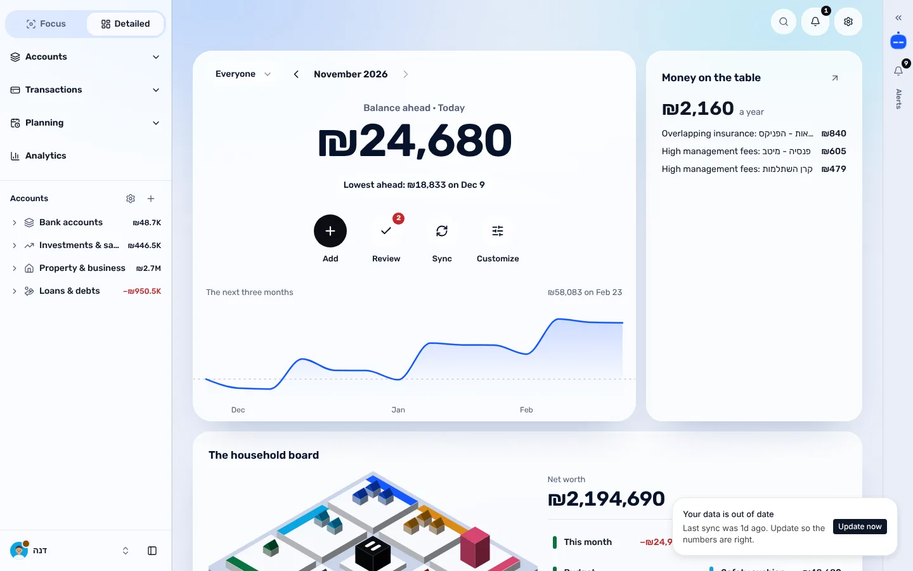

<div align="center">

# Penny

**A calm, local-first money app for Israeli households.**
Your banks, your budget and your future in one place, on your own computer.

[](https://github.com/Sergey-Bar/Penny/releases)
[](https://github.com/Sergey-Bar/Penny/releases/latest)
[](https://github.com/Sergey-Bar/Penny/actions/workflows/ci.yml)
[](LICENSE)

[עברית](README.md) · [Website](https://sergey-bar.github.io/Penny/en/) · [Clickable demo](https://sergey-bar.github.io/Penny/en/demo/) · [Live demo](https://penny-finance-demo.vercel.app) · [Download](https://github.com/Sergey-Bar/Penny/releases/latest)



</div>

Penny pulls transactions straight from your Israeli banks and credit cards, keeps them in one SQLite file on your computer, and helps with the questions that matter here: am I on track this month, do I have a safety net, am I paying too much in fees, and am I getting every tax benefit I'm owed. It listens only on 127.0.0.1, encrypts bank credentials with AES-256-GCM, and talks to nothing but your bank and, if you pick one, an AI provider. Hebrew first, with a full English interface.

> [!WARNING]
> Penny is a personal, local-only tool. Scraping financial institutions may violate their terms of service. Use it only for your own accounts, on your own machine. **Do not deploy it as a hosted service.**

## Features

- **18 Israeli banks and card companies** synced daily, plus CSV/XLSX statement import and a paste-anything smart sheet
- **Pension and savings** balances from Clal, Harel, Meitav, Menora and Migdal, or from your agent's report
- **Budgets, cash-flow forecast and "money on the table"**: one yearly figure for fees, idle cash and tax benefits you could claim
- **25+ Israeli calculators**: credit points and tax refund, pension fees, mortgage, rent vs buy, and more
- **Telegram bot**: spending feedback, bank one-time codes during a sync, sync alerts and a summary three mornings a week
- **Smart categories without AI**, or with Claude, a local Ollama model or a coding-agent CLI you already have
- **Household profiles**, phone access on your Wi-Fi (opt-in), app lock, encrypted backups and an [MCP server](docs/mcp.md) for AI agents

The full list: [docs/features.md](docs/features.md).

## Install

**Desktop app (Windows, macOS):** download the installer from the [latest release](https://github.com/Sergey-Bar/Penny/releases/latest). Windows updates itself.

**Docker (Windows, Mac, Linux):** install [Docker Desktop](https://www.docker.com/products/docker-desktop/), then:

```bash
# macOS / Linux
curl -fsSL https://raw.githubusercontent.com/Sergey-Bar/Penny/main/install-docker.sh | bash
```

```powershell
# Windows (PowerShell)
irm https://raw.githubusercontent.com/Sergey-Bar/Penny/main/install-docker.ps1 | iex
```

It downloads the newest release into `~/Penny`, builds it, and opens **http://127.0.0.1:41234**. Your data stays in the `penny-data` Docker volume.

**Update:** run the same command again. It backs up your data, builds the new version (tests included) and rolls back if it fails.

From source, other options and troubleshooting: [docs/install.md](docs/install.md). Statement files and the pension report: [docs/importing.md](docs/importing.md).

## Learn more

The [website](https://sergey-bar.github.io/Penny/en/) has the feature tour, guides and the clickable demo. Security: [SECURITY.md](SECURITY.md) and [docs/security.md](docs/security.md). What changed: [CHANGELOG.md](CHANGELOG.md).

## Contributing

Pull requests are welcome, especially new banks, AI providers and Israeli figures with an official source. Setup, rules and a code map: [CONTRIBUTING.md](CONTRIBUTING.md). Report vulnerabilities privately as described in [SECURITY.md](SECURITY.md).

## License

MIT. See [LICENSE](LICENSE) and [NOTICE.md](NOTICE.md) for upstream attribution.

Built on [`israeli-bank-scrapers`](https://github.com/eshaham/israeli-bank-scrapers), [Next.js](https://nextjs.org/), [React](https://react.dev/), [`shadcn/ui`](https://ui.shadcn.com/) on [`base-ui`](https://base-ui.com/), [`better-sqlite3`](https://github.com/WiseLibs/better-sqlite3), [`next-intl`](https://next-intl.dev/), [BoopFace](https://github.com/CX-ArtLab/BoopFace) by CX ArtLab (MIT, the face behind Pip), [Anthropic Claude](https://www.anthropic.com/) and [Ollama](https://ollama.com/).
