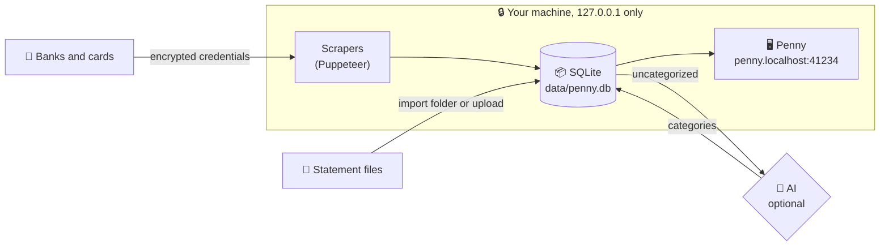

# Penny: features in detail

The short version is in the [README](../README.en.md). This page keeps the full list.

## Why Penny?

Israeli banks have poor exports, global budgeting apps don't understand shekels, credit points or study funds, and most cloud finance apps want your bank password on their servers.

Penny runs on your laptop. It pulls transactions straight from your banks and credit cards, keeps them in one SQLite file you can copy and back up, and lets an AI of your choice sort them into categories, or none at all. Then it helps with the questions that actually matter in Israel: am I on track this month, do I have a safety net, am I paying too much in fees, and am I getting every tax benefit I'm owed.

Nothing leaves your machine except the calls you choose: to your bank, to an AI provider if you pick a cloud one, and through the tunnel if you turn on remote access.

## Who it's for

- **Israeli households** that want all their money in one place: checking, credit cards, loans, savings and pension, in shekels and with local terms.
- **People who won't hand their bank password to a cloud service.** Penny runs on your computer, listens only on 127.0.0.1, and keeps your data in a local file (bank credentials encrypted with AES-256-GCM).
- **Couples and families** who share money, each with their own profile.
- **Hebrew speakers first** (full right-to-left), with a complete English interface too.

It is a poor fit if you want a fully hosted multi-tenant service, or bookkeeping for a business.

## Everyday money

- **A dashboard** of tiles you can show or hide (expected balance, money on the table, cash flow, spending structure, who spent what), and a calm **Focus** screen with just the bottom line.
- **Transactions** grouped by week, with category colours, search, filters, bulk edit, splits and tags. Add cash or manual transactions in a quick, amount-first sheet.
- **Budgets** with pacing, a 50/30/20 view, a table, an envelope view (how much of your income already has a job) and per-category detail.
- **Money on the table.** One yearly figure for everything you could save: fees, overdraft interest, FX markup, fund fees above the market, overlapping insurance, idle cash and the donation tax credit (section 46). Each with its next step; what you mark done counts as saved.
- **Why spending changed.** This month against the same days last month or last year, per merchant: price, volume, new, gone or one-off.
- **Splitting with people.** Mark who owes you part of an expense and see what each person owes, with "paid it all back" in one tap.
- **Category families.** Groups and subcategories share a colour family; pick categories by colour, A-Z or group, and create your own.
- **Financial health** score with one warnings button that lists everything that needs care.
- **What's ahead.** Upcoming charges, recurring bills and a cash-flow forecast, including a separate balance per bank account with a range, and a card for every credit card attached to the account that pays it.
- **Planned expenses.** A purchase you know is coming (a trip, a device, a repair) is written once, joins the forecast, and matches itself to the real charge when it arrives.
- **Business share and a business report.** A transaction that is partly work is marked with a business percentage; the original amount stays in the cash flow and card charges, and personal reports show only the household share. The business report (More → Business report) groups that share by month, category and merchant, with CSV export.

## Israeli money tools

More than 25 calculators and guided tools, ordered by life stage, each marked with the year its figures are valid for:

| Area | Tools |
|---|---|
| Tax | Credit points and tax-refund check (with a Form 135 checklist), tax-benefit deposits to pension and study fund, loss offset (Form 867), net from gross |
| Pension and retirement | Your fees against the market (links to Gemel-Net, Pensia-Net, Bituach-Net), clearing-house report guide, investment track choice, annuity vs lump sum, severance when changing jobs, early-retirement bridge to 67 |
| Safety net | Emergency fund, insurance list with double-insurance check, forgotten money (Har HaKesef) checklist, benefits check (work grant, reserve duty, child savings, arnona discounts) |
| Big decisions | Mortgage with 5-year variable tracks and Bank of Israel rules, prepay vs invest, rent vs buy, discounted-home lottery, car cost, lease vs buy |
| Everyday | Bank fee audit against the basic track, debt payoff, loan cost, savings goals, vacation budget, kids' investing |

Plus a **knowledge center** of short original guides in Hebrew and English, and daily tips.

## Pip, the household assistant

Pip has two layers. The companion keeps its mood and care list. The assistant answers questions from the household's own data, and is off until `pip_v2` is enabled.

- **Ask in plain words** from the global dock or `/ask`: affordability, spending changes, subscriptions, fees, pension, insurance, income stability, planned charges, syncing and what-if calculations.
- **Every answer has evidence.** The panel shows the tools used, the as-of date, the source ids and a "what Pip sees" disclosure. Knowledge answers carry a version and a citation.
- **Deterministic by default.** Without a model, Pip answers from the tool results. A configured provider can phrase the answer only after consent and only if every number matches the evidence.
- **Read-only.** Chat cannot change a transaction, move money or send an email. The tool registry has no write action.
- **Explicit memory.** A preference, goal or constraint is saved only when the user saves it, and can be read or deleted.
- **Daily briefing.** A short in-app card ranks the few things worth attention. Telegram delivery is optional.
- **Fail closed.** `PENNY_PIP_KILL=1` disables chat and briefings without deleting anything.

## Remote access

- **Off by default.** The app keeps listening locally.
- **Named Cloudflare tunnel with Access:** the recommended way to reach Penny from a phone. The proxy verifies the Access JWT and still requires the app lock.
- **Quick tunnel:** development only, explicitly acknowledged and never the default.
- **No wildcard hosts.** A remote hostname is added to the host guard only after it is configured, and a failed token check refuses the request before any route runs.

## Household

- **Profiles that share one household,** in a "who's using?" screen. Each person keeps their own home layout and accessibility choices.
- **Pip,** a small companion whose mood follows the household's finances. Pip is also the household's coach: alerts, insights and advice in a side rail, with one count on every screen. Each profile has its own picture (or its initial on a colour).
- **Every account in one place:** an accounts tree with group totals, a page per account, loans with progress, holdings with buys and sells, and your credit score over time.
- **Goals,** net worth, investments and pension balances (synced from Clal, Harel, Meitav, Menora and Migdal, or imported from your agent's report), and a "family document" for the day someone else needs to find everything.
- **Insurance** in one place: policies, what they cover and the excess, the renewal date, the agent, the documents, and the payments that match from the bank to the policy.
- **A lifetime money model** to age 90, and a coach that turns the month's numbers into ranked advice.
- **Demo mode** with a complete made-up household (see [install.md](install.md#demo-mode)).

## Getting data in

- **Automatic (beta):** 18 Israeli banks and card companies via [`israeli-bank-scrapers`](https://github.com/eshaham/israeli-bank-scrapers), on a daily schedule. Beta: a bank can change its site and break a connection until the scraper is fixed; statement files always work.
- **Manual:** drop a CSV, XLSX or XLS statement into the app or into a watched import folder. A transaction that comes from both is stored once. Details: [importing.md](importing.md).
- **Smart sheet:** paste a table from any source and fix each cell in the grid itself. Duplicates are found per account before saving, and the whole import can be undone.
- **Onboarding** walks a new user through profile and picture, connecting or importing, a monthly target, budgets, an optional AI provider and a short tour. It can be skipped, resumed and reopened.

## Language and accessibility

- **Hebrew first,** with a full right-to-left layout, and English. Bank names, categories, numbers and dates are localized.
- **Accessibility menu** (Alt+A): text size, contrast, stop animations, readable font, link highlighting and more, saved per profile, with an accessibility statement in line with IS 5568 and WCAG 2.2 AA.
- **Privacy mode** (Ctrl/⌘+Shift+P) hides amounts on screen.
- **Themes:** light, dark or follow the device, with soft motion for every open and close.

## Everything else, one line each

- **Ask your money** in plain language, and a **Telegram bot** for instant spending feedback, sync alerts and a summary three mornings a week.
- **Phone access on your Wi-Fi** (opt-in, protected by an access code), installable as a web app.
- **Rules** for recurring merchants: category, tags and owner are set on every sync and import.
- **Insights:** balance forecast, recurring charges and subscriptions, spending anomalies, remaining installments and upcoming obligations.
- **Trackers** for a period (say, "eating out until month end"), **guided reviews** in five short rounds, a **monthly recap**, and **your journey** with the household's big moments.
- **Financial independence (FI):** when your investments can cover your spending, with life events.
- **Markets:** indices, currencies and commodities, FX rates and fund prices for holdings; **ventures** (private deals) with invested, outstanding and realized gain.
- **Import from any text:** paste a statement, receipt or message and your chosen AI provider pulls out the transactions.
- **One-time codes (OTP)** from the bank go straight into the app or Telegram during a sync.
- **Backup and restore:** automatic backups, a backup before every schema change, restore from file, full data export, and a full wipe.
- **App lock** with a passphrase or PIN, and separate **workspaces** with multi-user access.
- **Desktop app** (Electron) for Windows and macOS with self-updates on Windows, or an **OS service** that starts with the computer, with a friendly local address.
- **MCP server** so an AI agent can read the household's numbers: [mcp.md](mcp.md).

## Supported institutions

| Type | Institutions |
|---|---|
| Banks | Hapoalim, Leumi, Discount, Mizrahi Tefahot, Mercantile, First International (FIBI), Otsar Hahayal, Pagi, Yahav, Massad, Union, One Zero, Beyahad Bishvilha, Behatsdaa |
| Credit cards | Isracard, Visa Cal, Max, American Express |
| Pension and savings | Clal, Harel, Meitav, Menora, Migdal (balances, via `israeli-pension-scrapers`) |

Not listed? Import its statement files, or add a scraper (see [CONTRIBUTING.md](../CONTRIBUTING.md)).

## AI providers

AI is optional. It categorizes new transactions and answers "ask your money" questions.

| | Claude API | Ollama | Coding-agent CLI | None |
|---|---|---|---|---|
| Runs | Anthropic cloud | Your machine | Vendor cloud, via the CLI you already use | Nowhere |
| Cost | A fraction of a shekel per sync | Free | Your existing plan | Free |
| Setup | API key | Install Ollama and pull a model | Claude Code, Codex, Gemini CLI, OpenCode or Kilo, in read-only mode | Nothing |

Change provider any time in **Settings → AI**. Even with no AI, new transactions get a category: first from what you corrected before for that merchant, then from a built-in dictionary of about 200 Israeli merchants (supermarkets, fuel, utilities, municipalities, health funds, telecom and more). AI, if you chose one, only sees what is left.

## How it works

## Security at a glance

| Concern | Defense |
|---|---|
| Credentials at rest | AES-256-GCM; the key file must be mode `0600` or the server refuses to start |
| Network exposure | Bound to `127.0.0.1` only. Phone access on your Wi-Fi is opt-in and protected by an access code |
| Remote access | Off by default; named Cloudflare Access JWT verification plus the app lock, or an explicitly acknowledged development quick tunnel |
| Browser CSRF | Origin / Referer checks on every request; destructive endpoints need an explicit confirmation |
| App lock | Optional passcode lock with automatic timeout |
| Bot detection | Chromium sandbox on by default (`PENNY_DISABLE_CHROMIUM_SANDBOX=1` to opt out) |
| Supply chain | `israeli-bank-scrapers`, `better-sqlite3` and `@anthropic-ai/sdk` pinned to exact versions |
| Browser hardening | Strict CSP, `X-Frame-Options: DENY`, a locked-down `Permissions-Policy` |
| Schema changes | The database is backed up automatically before any migration that rewrites data |

**Turn on full-disk encryption** (BitLocker, FileVault or LUKS). The key file sits next to the database, so disk encryption is your last line of defense if the laptop is lost. Full threat model and disclosure policy: [SECURITY.md](../SECURITY.md); the detailed review is in [security.md](security.md).

## Roadmap

- [x] Hebrew-first UI with full right-to-left layout
- [x] 18 banks and card companies, plus statement-file import
- [x] Custom categories with colour families
- [x] Household profiles, onboarding and accessibility menu
- [x] Israeli tax, pension, insurance and mortgage tools
- [x] Import the agent's pension report (JSON): products, fees, deposits and insurance
- [ ] Parse the pension clearing-house report automatically
- [x] CSV export for all transactions
- [x] Smart sheet import: paste, column mapping, category suggestions and per-account duplicates
- [x] Backup and restore in one encrypted file, plus `npm run backup`
- [x] Money on the table, why spending changed and the donation tax credit
- [x] Categorizing without AI: merchant memory and a built-in dictionary
- [x] Splitting expenses, envelope budgeting and credit score tracking
- [x] Windows self-update, and a clickable demo on the website
- [x] OFX export
- [x] Automatic encrypted backup to a cloud folder, and a support file for bug reports
- [x] Pip assistant with evidence, deterministic fallback, explicit memory and a daily briefing
- [x] Remote access with Cloudflare Access and the app lock
- [ ] Provider-chosen tools after the golden suite proves selection quality
- [ ] Native mobile companion
